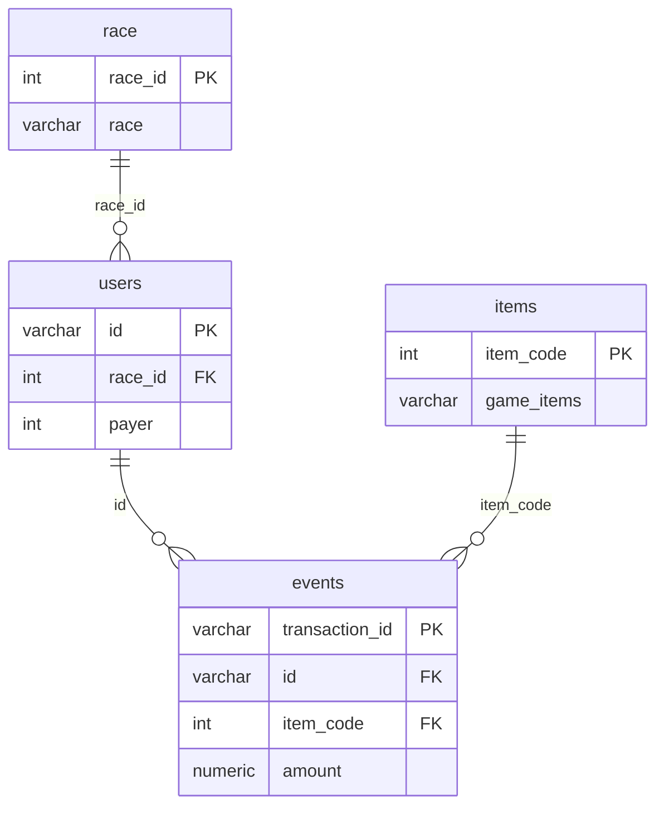

# SQL-скрипты и описание модели данных

Директория содержит SQL-скрипты (PostgreSQL) для исследовательского анализа монетизации игры «Секреты Темнолесья» и оценки покупательской активности в разрезе рас персонажей.

---

## Схема данных (`fantasy`)

В расчетах используются четыре таблицы базы данных `fantasy`:

### Описание таблиц

#### `fantasy.users` — профиль игроков

| Поле | Тип данных | Ключ | Бизнес-название | Описание |
| :--- | :--- | :---: | :--- | :--- |
| `id` | `varchar` | PK | Идентификатор игрока | Уникальный идентификатор зарегистрированного пользователя |
| `race_id` | `int` | FK | Идентификатор расы | Код расы персонажа (связь с `race.race_id`) |
| `payer` | `int` | — | Признак платящего игрока | Флаг покупки валюты «райские лепестки» за реальные деньги (`1` — платящий, `0` — неплатящий) |

#### `fantasy.race` — справочник рас персонажей

| Поле | Тип данных | Ключ | Бизнес-название | Описание |
| :--- | :--- | :---: | :--- | :--- |
| `race_id` | `int` | PK | Идентификатор расы | Уникальный код игровой расы |
| `race` | `varchar` | — | Название расы | Наименование расы персонажа (`Human`, `Orc`, `Hobbit`, `Northman`, `Elf`, `Angel`, `Demon`) |

#### `fantasy.events` — журнал внутриигровых покупок

| Поле | Тип данных | Ключ | Бизнес-название | Описание |
| :--- | :--- | :---: | :--- | :--- |
| `transaction_id` | `varchar` | PK | Идентификатор транзакции | Уникальный идентификатор внутриигровой покупки |
| `id` | `varchar` | FK | Идентификатор игрока | Идентификатор покупателя (связь с `users.id`) |
| `item_code` | `int` | FK | Код предмета | Код приобретенного эпического предмета (связь с `items.item_code`) |
| `amount` | `numeric` | — | Стоимость покупки | Стоимость транзакции во внутриигровой валюте |

#### `fantasy.items` — справочник эпических предметов

| Поле | Тип данных | Ключ | Бизнес-название | Описание |
| :--- | :--- | :---: | :--- | :--- |
| `item_code` | `int` | PK | Код предмета | Уникальный код эпического предмета |
| `game_items` | `varchar` | — | Название предмета | Игровое наименование эпического предмета |

---

## Состав скриптов

### 1. `01_eda.sql` — Исследовательский анализ данных (EDA)

- Расчет общей доли платящих игроков среди всех зарегистрированных пользователей.
- Расчет доли платящих игроков в разрезе рас персонажей.
- Расчет описательных статистик стоимости внутриигровых покупок (`COUNT`, `SUM`, `MIN`, `MAX`, `AVG`, медиана, `STDDEV`).
- Выявление объема и доли аномальных нулевых покупок (`amount = 0`).
- Ранжирование эпических предметов по числу платных продаж, доле в общих продажах и охвату покупателей.

### 2. `02_ad_hoc_analysis.sql` — Анализ активности игроков в разрезе рас

Скрипт реализован через последовательность CTE на платных транзакциях (`amount > 0`) и формирует сводную витрину по каждой расе:

- Общее количество зарегистрированных игроков и число активных покупателей.
- Доля покупателей среди зарегистрированных и доля платящих пользователей среди покупателей.
- Среднее количество покупок на одного покупателя.
- Средняя стоимость одной покупки и средняя суммарная сумма покупок на одного покупателя.
